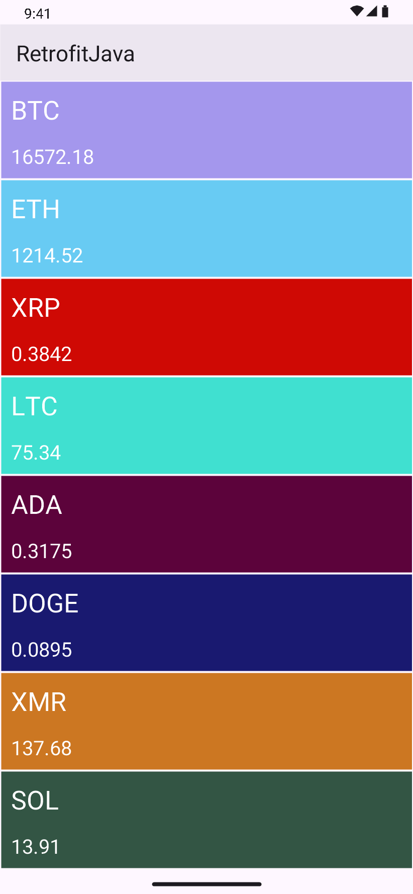

# RetrofitJava

[Türkçe](#tr) · [English](#english)



*Örnek fiyatlarla temsili uygulama görünümü · Representative app preview with illustrative prices*

<a name="tr"></a>

## Türkçe

Retrofit ile veri çekmeyi ve RxJava 2 ile isteği yönetmeyi öğrenmek için bu küçük Android uygulamasını Java ile yazdım. Uygulama açıldığında GitHub’daki örnek veri dosyasını indirip kripto para sembollerini ve fiyatlarını kaydırılabilir bir listede gösteriyorum. [K21-JSONDataSet — crypto.json](https://github.com/atilsamancioglu/K21-JSONDataSet/blob/master/crypto.json)

### Nasıl çalışıyor?

- `CryptoAPI` arayüzündeki GET isteği `Observable<List<CryptoModel>>` döndürüyor. Bu dönüş tipini kullanmak için Retrofit’e `RxJava2CallAdapterFactory` ekledim.
- `MainActivity` açıldığında isteği `Schedulers.io()` ile arka planda çalıştırıyorum. Gson, JSON yanıtındaki `currency` ve `price` alanlarını `CryptoModel` nesnelerine eşliyor.
- RxAndroid’in `AndroidSchedulers.mainThread()` zamanlayıcısıyla ana iş parçacığına geçip sonucu `RecyclerViewAdapter` ile `RecyclerView`’da gösteriyorum. Her satırda sembol ve fiyat alt alta yer alıyor. Arka plan renkleri sekiz satırda bir tekrar ediyor.
- `MainActivity` yok edildiğinde `onDestroy()` içinde `CompositeDisposable.clear()` ile aboneliği temizliyorum.

### Çalıştırma

1. Depoyu klonlayın ve `RetrofitJava` klasörünü Android Studio’da açın.

   ```bash
   git clone https://github.com/bayyazar/RetrofitJava.git
   ```

2. Android SDK Platform 36’yı yükleyin, Gradle JDK olarak JDK 17’yi seçin ve projeyi senkronize edin. Kaynak kodu Java 11 dil düzeyinde derlenecek şekilde ayarladım. [Gradle için JDK ayarları](https://developer.android.com/build/jdks)
3. `app` modülünü internete bağlı bir emülatörde veya cihazda çalıştırın. En düşük desteklenen sürüm Android 8.1 (API 27). Veri isteği için API anahtarı gerekmiyor.

## English

I wrote this small Android app in Java to practice fetching data with Retrofit and managing the request with RxJava 2. When the app opens, I fetch a sample dataset from GitHub and display the cryptocurrency symbols and prices in a scrollable list. [K21-JSONDataSet — crypto.json](https://github.com/atilsamancioglu/K21-JSONDataSet/blob/master/crypto.json)

### How it works

- The GET request in `CryptoAPI` returns an `Observable<List<CryptoModel>>`. I added `RxJava2CallAdapterFactory` to Retrofit to support that return type.
- When `MainActivity` opens, I run the request in the background with `Schedulers.io()`. Gson maps the `currency` and `price` fields in the JSON response to `CryptoModel` objects.
- I use RxAndroid’s `AndroidSchedulers.mainThread()` to switch to the main thread and display the result in a `RecyclerView` using `RecyclerViewAdapter`. Each row shows the symbol above the price. The background colors repeat every eight rows.
- When `MainActivity` is destroyed, I call `CompositeDisposable.clear()` in `onDestroy()` to dispose of the subscription.

### Running the app

1. Clone the repository and open the `RetrofitJava` folder in Android Studio.

   ```bash
   git clone https://github.com/bayyazar/RetrofitJava.git
   ```

2. Install Android SDK Platform 36, select JDK 17 as the Gradle JDK, and sync the project. I set the source compatibility to Java 11. [Gradle JDK settings](https://developer.android.com/build/jdks)
3. Run the `app` module on an emulator or device with internet access. The minimum supported version is Android 8.1 (API 27). The data request requires no API key.
